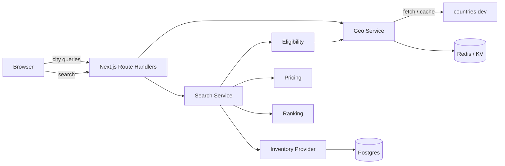

# Car Rental Search — Implementation Plan

**Status:** MVP implemented · **Version:** 1.1 · **Date:** 2026-11-05
**Stack:** Next.js (App Router) + TypeScript · Postgres + Prisma · Zod
**Geo source:** [countries.dev](https://countries.dev) (keyless, 60 req/s per IP, edge-cached)

> **Implementation note:** This plan is implemented in this repo (see
> [README.md](./README.md)). The running MVP uses an in-memory
> `InventoryProvider` instead of Postgres/Prisma so it can run without external
> services. The Prisma schema in §7 remains the target persistence model for
> stations, vehicles, and bookings.

---

## 1. Summary

Build a car-rental search flow where a user picks a **pickup city**, a **drop-off city**, and a
**rental date range**, then receives a ranked list of available cars.

The defining business constraint:

> Pickup and drop-off must be in the **same country**, or in two countries that **share a land
> border**. Border eligibility is derived from the `borders` array returned by
> `GET https://countries.dev/countries`.

The "best" result is a **best overall car offer**, computed from price, station distance,
supplier rating, and cancellation flexibility. Multi-stop itinerary/route ordering is explicitly
out of scope for this version.

This document is the implementation spec: product rules, external API integration, data model,
API contracts, validation, ranking, UX, testing, and phased rollout.

---

## 2. Goals and non-goals

### Goals

- City autocomplete backed by countries.dev, proxied and cached server-side.
- Server-authoritative country eligibility: same country or land-border neighbour.
- Date-range validation with timezone-aware handling and 24-hour rental-day pricing.
- Availability-aware offer search from a pluggable inventory provider.
- Deterministic "best offer" ranking with a transparent score breakdown.
- A clean, testable API boundary between geo data, eligibility, inventory, and ranking.
- Production concerns: caching, rate-limit protection, failure handling, observability, tests.

### Non-goals (v1)

- Multi-stop route optimization / travelling-salesman ordering.
- Payments and checkout.
- Real supplier integration. The plan defines an `InventoryProvider` interface and ships a
  seeded mock provider; a real vendor adapter can be dropped in later.
- Admin/back-office tooling.
- Ferry, tunnel, and air connections. Only land borders from countries.dev count.
- Address-level geocoding. Cities are the location unit.

---

## 3. Key decisions

| Area | Decision |
|---|---|
| Geo data | countries.dev only; no local country/city tables in v1 |
| Location unit | City (`geonameId` is the canonical key) |
| Country constraint | Same country **or** land-border neighbour, symmetric |
| Border source | `/countries?fields=...&borders` (alpha-3 array) |
| Date transport | ISO 8601 instants (UTC); city IANA timezone for display |
| Rental-day billing | 24-hour blocks with a 29-minute grace period, minimum 1 day |
| Optimization | Weighted 0–100 score (price 60%, distance 20%, rating 10%, flexibility 10%) |
| Inventory | `InventoryProvider` interface + seeded mock implementation |
| Validation | Zod at the API boundary; server re-validates on booking |
| Persistence | Postgres via Prisma for stations, vehicles, bookings, border fees |
| Cache | Redis/KV in production; in-memory LRU in development |

---

## 4. Product rules (normative)

### 4.1 Location and eligibility

- **R1.** A pickup or drop-off location is a city record from countries.dev. The client sends
  `geonameId`; the server resolves the city and its `countryCode`. The client **MUST NOT** be
  trusted to supply a country code.
- **R2.** If `pickup.countryCode === dropoff.countryCode`, the route is **DOMESTIC** and allowed
  (including same-city pickup/drop-off).
- **R3.** Otherwise, the route is **BORDER** and allowed only if the two countries are land-border
  neighbours according to the normalized country index. The relation **MUST** be treated as
  symmetric, even if the upstream data is asymmetric.
- **R4.** If neither condition holds, reject with `ROUTE_NOT_ALLOWED`. Never "fail open" on
  eligibility.
- **R5.** Countries with no land borders (e.g., Japan, Australia) are domestic-only under this
  rule. Territories follow their parent country's ISO code in the dataset.
- **R6.** A **BORDER** route is flagged as cross-border in the UI and may carry a one-way fee.
  The fee comes from the inventory provider or the `BorderFee` table; if neither is available,
  the offer is marked `requiresQuote` and excluded from default ranking.
- **R7.** Only cities in served countries, and (Phase 3) cities with at least one active station
  within the configured radius, are offered in autocomplete. Search may still return
  `NO_STATIONS` for an otherwise valid city pair.

> **Important edge case.** The rule is country-level, not city-level. `GB → IE` is allowed even
> though London → Dublin requires a ferry, because the UK and Ireland share a land border. See
> §16 for the optional city-pair distance guard.

### 4.2 Dates and rental duration

- **R8.** The API accepts `from` and `to` as ISO 8601 instants with an offset or `Z`. The UI
  displays them in each city's IANA timezone (`city.timezone`).
- **R9.** Rules:
  - `from` must be at least **2 hours** in the future (`SEARCH_LEAD_TIME`).
  - `to` must be **strictly after** `from`.
  - Minimum duration: **1 hour** (search); billing minimum is 1 rental day.
  - Maximum duration: **90 days**.
  - `from` must be within a **365-day** booking window.
- **R10.** Rental days use 24-hour blocks with a 29-minute grace period:

  ```ts
  const rentalDays = Math.max(
    1,
    Math.ceil((durationMinutes - 29) / 1440)
  );
  ```

  Examples: 24h 00m → 1 day, 24h 29m → 1 day, 24h 30m → 2 days, 48h 00m → 2 days.
- **R11.** DST is handled by transporting instants, not wall-clock strings. If a wall-clock time
  falls in a DST gap or overlap, the client resolves it to an instant using the city timezone
  before calling search; the server stores both the instant and the local-time snapshot on
  booking.

### 4.3 Offer ranking

- **R12.** The default `best` sort uses the weighted score in §10.3. The API also supports
  `cheapest`, `closest`, and `rating`.
- **R13.** Ranking is deterministic: after the score, ties break by total price ascending,
  distance ascending, rating descending, then `offerId` ascending.
- **R14.** `best` is computed over the full candidate set, then paginated. Pagination **MUST NOT**
  rank only the current page.

---

## 5. countries.dev integration

### 5.1 Endpoints used

| Purpose | Request | Notes |
|---|---|---|
| Country index + borders | `GET /countries?fields=name,alpha2Code,alpha3Code,borders,region,currencies,timezones,flag` | One call builds the whole eligibility index |
| Single country | `GET /alpha/{alpha2}` | Fallback / detail view |
| City autocomplete | `GET /cities?q={q}&country={alpha2}&limit={n}` | `limit` max 100; `country` is alpha-2 |
| City by id | `GET /cities/{geonameId}` | Canonical city resolution |
| Nearest cities | `GET /cities/near?lat={lat}&lng={lng}` | Optional "nearest city" UX |
| Distance | `GET /distance?from={id}&to={id}` | Reference only; use local haversine for stations |

Do **not** use `GET /borders/{country}` in the request path: it requires an exact country name
and is brittle for aliases/casing. The `borders` array from `/countries` is the source of truth.

### 5.2 Response shapes (trimmed)

City:

```json
{
  "geonameId": 2867714,
  "name": "Munich",
  "asciiName": "Munich",
  "countryCode": "DE",
  "admin1Code": "02",
  "latitude": 48.13743,
  "longitude": 11.57549,
  "population": 1505005,
  "timezone": "Europe/Berlin",
  "featureCode": "PPLA"
}
```

Country:

```json
{
  "name": "Germany",
  "alpha2Code": "DE",
  "alpha3Code": "DEU",
  "borders": ["AUT", "BEL", "CZE", "DNK", "FRA", "LUX", "NLD", "POL", "CHE"],
  "region": "Europe",
  "currencies": [{ "code": "EUR", "name": "Euro", "symbol": "€" }],
  "timezones": ["UTC+01:00"],
  "flag": "🇩🇪"
}
```

Key mismatch to handle: **cities return alpha-2**, while **`borders` returns alpha-3**. The index
must map both.

### 5.3 Country index and border resolution

Build a single cached index at startup / first request:

```ts
export interface CountryRecord {
  name: string;
  alpha2Code: string;
  alpha3Code: string;
  borders?: string[];
  region: string;
  currencies: { code: string; name: string; symbol: string }[];
  timezones: string[];
  flag: string;
}

export interface CountryIndex {
  byAlpha2: Map<string, CountryRecord>;
  byAlpha3: Map<string, CountryRecord>;
  neighbours: Map<string, Set<string>>; // alpha-2 -> alpha-2 set, symmetric
  fetchedAt: number;
}

const COUNTRY_FIELDS = [
  "name",
  "alpha2Code",
  "alpha3Code",
  "borders",
  "region",
  "currencies",
  "timezones",
  "flag",
].join(",");

export async function loadCountryIndex(): Promise<CountryIndex> {
  const rows: CountryRecord[] = await fetch(
    `https://countries.dev/countries?fields=${COUNTRY_FIELDS}`
  ).then((r) => r.json());

  const byAlpha2 = new Map(rows.map((c) => [c.alpha2Code.toUpperCase(), c]));
  const byAlpha3 = new Map(rows.map((c) => [c.alpha3Code.toUpperCase(), c]));
  const neighbours = new Map<string, Set<string>>();

  const link = (a: string, b: string) => {
    if (!neighbours.has(a)) neighbours.set(a, new Set());
    neighbours.get(a)!.add(b);
  };

  for (const country of rows) {
    for (const borderAlpha3 of country.borders ?? []) {
      const neighbour = byAlpha3.get(borderAlpha3.toUpperCase());
      if (!neighbour) {
        // Non-ISO codes and dataset gaps are possible. Log, ignore, never allow.
        telemetry.increment("geo.unknown_border_code", { code: borderAlpha3 });
        continue;
      }
      link(country.alpha2Code.toUpperCase(), neighbour.alpha2Code.toUpperCase());
      link(neighbour.alpha2Code.toUpperCase(), country.alpha2Code.toUpperCase());
    }
  }

  return { byAlpha2, byAlpha3, neighbours, fetchedAt: Date.now() };
}
```

Some records omit `borders` entirely (e.g., island territories such as Åland); treat a missing
array as no land borders.

Eligibility:

```ts
export type RouteRelationship = "DOMESTIC" | "BORDER" | "INVALID";

export function classifyRoute(
  pickupCountry: string,
  dropoffCountry: string,
  index: CountryIndex
): RouteRelationship {
  const pickup = pickupCountry.toUpperCase();
  const dropoff = dropoffCountry.toUpperCase();

  if (!index.byAlpha2.has(pickup) || !index.byAlpha2.has(dropoff)) {
    throw new GeoUnavailableError("Country not present in index");
  }

  if (pickup === dropoff) return "DOMESTIC";
  if (index.neighbours.get(pickup)?.has(dropoff)) return "BORDER";
  return "INVALID";
}
```

Worked example (Germany, from the live API):

- `borders`: `AUT, BEL, CZE, DNK, FRA, LUX, NLD, POL, CHE`
- Munich → Salzburg (`DE → AT`): **BORDER, allowed**
- Munich → Zurich (`DE → CH`): **BORDER, allowed**
- Munich → London (`DE → GB`): **INVALID**, allowed list is `DE + the nine neighbours`
- Munich → Berlin (`DE → DE`): **DOMESTIC, allowed**

### 5.4 City autocomplete strategy

**Pickup:** one upstream call, no country filter.

```
GET /cities?q={q}&limit=10
```

**Drop-off:** once a pickup city is chosen, only cities in the allowed countries are useful.
Because `/cities` accepts a single `country` filter, fan out per allowed country in parallel:

```
GET /cities?q={q}&country=DE&limit=5
GET /cities?q={q}&country=AT&limit=5
...
```

- Cap the fan-out at **12 countries** per request.
- Merge by `geonameId`, sort by `population` descending, take `limit`.
- Cache each `(normalizedQ, country, limit)` result for 24 hours.
- Use `AbortController` on the client and a 300 ms debounce; require `q.length >= 2`.
- Do not call countries.dev from the browser: all users would share the server's egress IP and
  the 60 req/s ceiling. Proxy through our API and cache.

If fan-out is undesirable for an early prototype, the fallback is a single
`GET /cities?q={q}&limit=100` followed by filtering. This is simpler but biases results toward
large cities and can miss small border towns; treat it as a temporary fallback, not the target.

### 5.5 Caching and rate limiting

| Data | Cache key | TTL | Fallback |
|---|---|---|---|
| Country index | `geo:countries:v1` | 24 h | Serve stale up to 7 days |
| Neighbour sets | derived, same as index | — | Rebuild from index |
| City search | `geo:cities:{country}:{q}:{limit}` | 24 h | Serve stale up to 7 days |
| City by id | `geo:city:{geonameId}` | 7 d | Serve stale |
| Search results | `search:{sha256(params)}` | 30 s (optional) | Skip cache |

- Respect upstream `Cache-Control` (`s-maxage=86400, stale-while-revalidate=604800`).
- Use single-flight/lock per key to avoid a cache stampede on cold start.
- Cache in Redis/KV in production; use an in-process LRU in development.
- Prefetch the country index on boot and after deploy.
- Apply our own global outbound limiter (e.g., 20 req/s) to stay well below 60 req/s.

### 5.6 Failure behaviour

| Failure | Behaviour |
|---|---|
| Timeout / 5xx from countries.dev | Serve stale index; if none, `503 GEO_UNAVAILABLE` |
| `429 Too Many Requests` | Back off with jitter, retry once, then serve stale |
| Unknown border code | Log metric, ignore that edge, never allow the route |
| City not found | `404 UNKNOWN_CITY` |
| Upstream 400 | Treat as bug; log payload, return `502 GEO_UPSTREAM_ERROR` |
| Invalid upstream shape | Zod parse fails, log, return `502`; serve stale if available |

Eligibility must **fail closed**: if the country index is unavailable and no usable cache exists,
the search fails with a clear retry message rather than allowing a potentially illegal route.

### 5.7 Attribution

countries.dev data is derived from GeoNames (CC BY 4.0). Include attribution in the site footer
or an "About this data" link. Do not imply the data is owned by us.

---

## 6. Architecture



**Request path for search:**

1. Validate query with Zod.
2. Resolve pickup and drop-off cities from the geo cache.
3. Classify route (`DOMESTIC` / `BORDER` / `INVALID`).
4. Load candidate stations in each city's country within the radius.
5. Fetch offers from the inventory provider.
6. Filter availability and price them.
7. Rank, paginate, and return.

**Repository layout:**

```
src/
  app/
    (search)/page.tsx
    api/geo/cities/route.ts
    api/geo/countries/[code]/neighbours/route.ts
    api/search/route.ts
    api/bookings/route.ts
  components/search/
    LocationCombobox.tsx
    DateRangePicker.tsx
    SearchResults.tsx
    OfferCard.tsx
  lib/geo/
    types.ts
    countries.ts        # index build, cache, neighbours
    cities.ts           # search, fan-out, merge
    eligibility.ts      # classifyRoute, allowed countries
  lib/search/
    query-schema.ts     # Zod
    service.ts          # orchestration
    pricing.ts
    ranking.ts
  lib/inventory/
    provider.ts         # interface
    mock-provider.ts
  lib/cache/kv.ts
  db/
    schema.prisma
    seed.ts
tests/
  unit/eligibility.test.ts
  unit/dates.test.ts
  unit/ranking.test.ts
  contract/countries-dev.test.ts
  e2e/search.spec.ts
```

---

## 7. Data model

### 7.1 Domain types

```ts
export interface CityRef {
  geonameId: number;
  name: string;
  countryCode: string; // ISO 3166-1 alpha-2, uppercase
  admin1Code: string;
  latitude: number;
  longitude: number;
  timezone: string; // IANA
}

export interface CityResolution extends CityRef {
  countryName: string;
  flag: string;
}

export interface RentalWindow {
  from: Date;
  to: Date;
  rentalDays: number;
}

export interface StationSummary {
  id: string;
  name: string;
  distanceKm: number;
}

export interface ScoreBreakdown {
  priceScore: number;
  distanceScore: number;
  ratingScore: number;
  flexibilityScore: number;
}

export type SortOption = "best" | "cheapest" | "closest" | "rating";

export interface SearchQuery {
  pickupCityId: number;
  dropoffCityId: number;
  from: Date;
  to: Date;
  sort: SortOption;
  page: number;
  pageSize: number;
  currency: string;
}

export interface PriceBreakdown {
  currency: string;
  baseCents: number;
  oneWayFeeCents: number;
  taxesCents: number;
  totalCents: number;
  requiresQuote?: boolean;
}

export interface Offer {
  offerId: string;
  vehicle: {
    class: string;
    name: string;
    seats: number;
    transmission: "manual" | "automatic";
  };
  supplier: { id: string; name: string; rating: number };
  pickupStation: StationSummary;
  dropoffStation: StationSummary;
  pickupDistanceKm: number;
  dropoffDistanceKm: number;
  price: PriceBreakdown;
  freeCancellation: boolean;
  available: boolean;
  score?: number;
  scoreBreakdown?: ScoreBreakdown;
  badges?: string[];
}

export interface InventorySearchInput {
  pickupCity: CityRef;
  dropoffCity: CityRef;
  pickupStations: StationSummary[];
  dropoffStations: StationSummary[];
  from: Date;
  to: Date;
  rentalDays: number;
  currency: string;
}

export interface InventoryProvider {
  readonly name: string;
  search(input: InventorySearchInput): Promise<Offer[]>;
  getOffer(offerId: string): Promise<Offer | null>;
}
```

### 7.2 Prisma schema

Country and city records are **not** persisted in v1; they live in the geo cache. Booking rows
snapshot the resolved city/country names so historical records remain readable.

```prisma
enum BookingStatus {
  PENDING
  CONFIRMED
  CANCELLED
  EXPIRED
}

model Supplier {
  id       String    @id @default(cuid())
  name     String
  rating   Float     @default(4.0)
  stations Station[]
  vehicles Vehicle[]
}

model Station {
  id            String   @id @default(cuid())
  supplierId    String
  supplier      Supplier @relation(fields: [supplierId], references: [id])
  name          String
  countryCode   String   @db.Char(2)
  cityGeonameId Int
  latitude      Decimal  @db.Decimal(9, 6)
  longitude     Decimal  @db.Decimal(9, 6)
  timezone      String
  active        Boolean  @default(true)
  vehicles      Vehicle[]

  @@index([countryCode, cityGeonameId])
  @@index([latitude, longitude])
}

model Vehicle {
  id             String   @id @default(cuid())
  supplierId     String
  supplier       Supplier @relation(fields: [supplierId], references: [id])
  stationId      String
  station        Station  @relation(fields: [stationId], references: [id])
  class          String
  name           String
  seats          Int
  transmission   String
  dailyRateCents Int
  currency       String   @db.Char(3)
  freeCancellation Boolean @default(false)
  active         Boolean  @default(true)

  @@index([stationId])
}

model Booking {
  id                    String        @id @default(cuid())
  status                BookingStatus @default(PENDING)
  idempotencyKey        String        @unique
  pickupCityGeonameId   Int
  pickupCityName        String
  pickupCountryCode     String        @db.Char(2)
  pickupAt              DateTime
  dropoffCityGeonameId  Int
  dropoffCityName       String
  dropoffCountryCode    String        @db.Char(2)
  dropoffAt             DateTime
  rentalDays            Int
  offerSnapshot         Json
  totalCents            Int
  currency              String        @db.Char(3)
  providerRef           String?
  createdAt             DateTime      @default(now())
  updatedAt             DateTime      @updatedAt

  @@index([pickupAt, dropoffAt])
  @@index([pickupCountryCode, dropoffCountryCode])
}

model BorderFee {
  pickupCountryCode  String @db.Char(2)
  dropoffCountryCode String @db.Char(2)
  feeCents           Int
  currency           String @db.Char(3)

  @@id([pickupCountryCode, dropoffCountryCode])
}
```

Availability in the mock provider is derived from overlapping `CONFIRMED` bookings. A real
provider adapter will use the supplier's availability API instead.

---

## 8. API specification

### 8.1 Endpoints

| Method | Path | Purpose |
|---|---|---|
| GET | `/api/geo/cities` | City autocomplete, optional allowed-country filter |
| GET | `/api/geo/countries/[code]/neighbours` | Allowed drop-off countries for a pickup |
| GET | `/api/search` | Validate route + dates and return ranked offers |
| POST | `/api/bookings` | Re-validate and create a booking hold (Phase 4) |
| GET | `/api/health` | Liveness/readiness (optional) |

All responses are JSON. Every response carries an `x-request-id` header; errors include it in
the body.

### 8.2 City autocomplete

```
GET /api/geo/cities?q=sal&allowedCountries=DE,AT&limit=10
```

| Param | Required | Rules |
|---|---|---|
| `q` | yes | 2–64 chars; trimmed; accent-insensitive upstream match |
| `country` | no | Single alpha-2 filter (advanced use) |
| `allowedCountries` | no | Comma-separated alpha-2 codes; max 12 |
| `limit` | no | 1–20, default 10 |

Response:

```json
{
  "cities": [
    {
      "geonameId": 2766824,
      "name": "Salzburg",
      "asciiName": "Salzburg",
      "countryCode": "AT",
      "countryName": "Austria",
      "flag": "🇦🇹",
      "admin1Code": "05",
      "latitude": 47.79941,
      "longitude": 13.04399,
      "population": 157245,
      "timezone": "Europe/Vienna"
    }
  ]
}
```

If `q.length < 2`, return `200 { "cities": [] }` rather than an error; this keeps the UI simple.

### 8.3 Allowed countries

```
GET /api/geo/countries/DE/neighbours
```

```json
{
  "countryCode": "DE",
  "countryName": "Germany",
  "allowedCountries": [
    { "countryCode": "DE", "name": "Germany", "flag": "🇩🇪", "relationship": "DOMESTIC" },
    { "countryCode": "AT", "name": "Austria", "flag": "🇦🇹", "relationship": "BORDER" }
  ]
}
```

This endpoint is a UI convenience. It is **not** the enforcement point; `/api/search` and
`/api/bookings` re-resolve and re-validate.

### 8.4 Search

```
GET /api/search
  ?pickupCityId=2867714
  &dropoffCityId=2766824
  &from=2026-11-10T09:00:00Z
  &to=2026-11-14T09:00:00Z
  &sort=best
  &page=1
  &pageSize=10
  &currency=EUR
```

| Param | Rules |
|---|---|
| `pickupCityId`, `dropoffCityId` | positive integers; must resolve |
| `from`, `to` | ISO 8601 with offset or `Z` |
| `sort` | `best` (default), `cheapest`, `closest`, `rating` |
| `page` | ≥ 1, default 1 |
| `pageSize` | 1–50, default 10 |
| `currency` | ISO 4217, default `EUR` |

Response `200`:

```json
{
  "searchId": "srch_01JB...",
  "route": {
    "pickup": {
      "cityId": 2867714,
      "city": "Munich",
      "countryCode": "DE",
      "countryName": "Germany",
      "timezone": "Europe/Berlin"
    },
    "dropoff": {
      "cityId": 2766824,
      "city": "Salzburg",
      "countryCode": "AT",
      "countryName": "Austria",
      "timezone": "Europe/Vienna"
    },
    "relationship": "BORDER",
    "crossBorder": true,
    "allowedCountries": ["DE", "AT", "BE", "CH", "CZ", "DK", "FR", "LU", "NL", "PL"]
  },
  "rental": {
    "from": "2026-11-10T09:00:00.000Z",
    "to": "2026-11-14T09:00:00.000Z",
    "rentalDays": 4
  },
  "offers": [
    {
      "offerId": "off_01JB...",
      "vehicle": {
        "class": "compact",
        "name": "VW Golf or similar",
        "seats": 5,
        "transmission": "manual"
      },
      "supplier": { "id": "sup_1", "name": "Alpine Rent", "rating": 4.6 },
      "pickupStation": { "id": "st_1", "name": "Munich Central", "distanceKm": 1.2 },
      "dropoffStation": { "id": "st_2", "name": "Salzburg Hbf", "distanceKm": 0.8 },
      "price": {
        "currency": "EUR",
        "baseCents": 24000,
        "oneWayFeeCents": 5000,
        "taxesCents": 5300,
        "totalCents": 34300
      },
      "freeCancellation": true,
      "score": 97.4,
      "scoreBreakdown": {
        "priceScore": 1.0,
        "distanceScore": 0.92,
        "ratingScore": 0.9,
        "flexibilityScore": 1.0
      },
      "badges": ["BEST_OVERALL"]
    }
  ],
  "meta": {
    "total": 18,
    "page": 1,
    "pageSize": 10,
    "sort": "best",
    "rankingVersion": "v1",
    "reason": null
  }
}
```

Empty results are still `200`, with `meta.reason` set to `NO_STATIONS` or `NO_AVAILABILITY`:

```json
{ "offers": [], "meta": { "total": 0, "reason": "NO_AVAILABILITY" } }
```

### 8.5 Errors

Error envelope:

```json
{
  "error": {
    "code": "ROUTE_NOT_ALLOWED",
    "message": "Drop-off in the United Kingdom is not available for a pickup in Germany.",
    "details": {
      "pickupCountryCode": "DE",
      "dropoffCountryCode": "GB",
      "allowedCountries": ["DE", "AT", "BE", "CH", "CZ", "DK", "FR", "LU", "NL", "PL"]
    },
    "requestId": "req_01JB..."
  }
}
```

| Code | HTTP | Meaning |
|---|---|---|
| `INVALID_QUERY` | 400 | Zod/schema failure, bad param type |
| `INVALID_DATE_RANGE` | 400 | `to <= from`, too short, too long, past lead time |
| `UNKNOWN_CITY` | 404 | `geonameId` not found upstream |
| `COUNTRY_NOT_SERVED` | 422 | No stations/operations in a country |
| `CURRENCY_UNSUPPORTED` | 422 | Requested currency not supported in v1 |
| `ROUTE_NOT_ALLOWED` | 422 | Different countries with no land border |
| `GEO_UNAVAILABLE` | 503 | Country index unavailable with no usable cache |
| `GEO_UPSTREAM_ERROR` | 502 | countries.dev returned malformed/unexpected data |
| `INVENTORY_UNAVAILABLE` | 503 | Provider failure; retryable |
| `PRICE_CHANGED` | 409 | Booking re-quote differs beyond tolerance |
| `OFFER_UNAVAILABLE` | 410 | Offer no longer bookable |

Use `422` for business-rule violations and `400` for malformed input. Do not leak upstream
error bodies to clients.

### 8.6 Booking (Phase 4)

```
POST /api/bookings
Idempotency-Key: 6f1c...
```

```json
{
  "offerId": "off_01JB...",
  "pickupCityId": 2867714,
  "dropoffCityId": 2766824,
  "from": "2026-11-10T09:00:00Z",
  "to": "2026-11-14T09:00:00Z",
  "driver": { "firstName": "Ada", "lastName": "Lovelace", "email": "ada@example.com" }
}
```

Server flow:

1. Look up the idempotency key; return the existing booking if present.
2. Re-resolve cities and re-run eligibility and date validation.
3. Re-fetch the offer from the provider and compare the total. If the increase exceeds
   `PRICE_TOLERANCE_PCT` (default 5%), return `409 PRICE_CHANGED` with the new quote.
4. Create the provider hold, then persist the booking in a transaction.
5. Return `201` with the booking id and hold expiry.

---

## 9. Validation specification

### 9.1 Zod schema

```ts
import { z } from "zod";

const cityId = z.coerce.number().int().positive();

const instant = z
  .string()
  .datetime({ offset: true })
  .transform((value) => new Date(value));

export const searchQuerySchema = z
  .object({
    pickupCityId: cityId,
    dropoffCityId: cityId,
    from: instant,
    to: instant,
    sort: z.enum(["best", "cheapest", "closest", "rating"]).default("best"),
    page: z.coerce.number().int().min(1).default(1),
    pageSize: z.coerce.number().int().min(1).max(50).default(10),
    currency: z.string().regex(/^[A-Z]{3}$/).default("EUR"),
  })
  .superRefine((value, ctx) => {
    const now = Date.now();
    const durationMs = value.to.getTime() - value.from.getTime();

    if (durationMs <= 0) {
      ctx.addIssue({ code: "custom", path: ["to"], message: "Drop-off must be after pickup." });
    }

    const leadMs = value.from.getTime() - now;
    if (leadMs < 2 * 60 * 60 * 1000) {
      ctx.addIssue({ code: "custom", path: ["from"], message: "Pickup must be at least 2 hours from now." });
    }

    if (durationMs < 60 * 60 * 1000) {
      ctx.addIssue({ code: "custom", path: ["to"], message: "Minimum rental duration is 1 hour." });
    }

    if (durationMs > 90 * 24 * 60 * 60 * 1000) {
      ctx.addIssue({ code: "custom", path: ["to"], message: "Maximum rental duration is 90 days." });
    }

    if (leadMs > 365 * 24 * 60 * 60 * 1000) {
      ctx.addIssue({ code: "custom", path: ["from"], message: "Pickup is outside the booking window." });
    }
  });
```

### 9.2 Search validation order

1. Parse and validate the query (400 on failure).
2. Resolve pickup city (404 if missing).
3. Resolve drop-off city (404 if missing).
4. Verify both countries are served (422 `COUNTRY_NOT_SERVED`).
5. Classify the route (422 `ROUTE_NOT_ALLOWED`).
6. Load stations in each city within `STATION_RADIUS_KM` (default 50 km), constrained to the
   city's country.
7. If either side has no stations, return `200` with `NO_STATIONS`.
8. Fetch and price offers.
9. If no offer is available, return `200` with `NO_AVAILABILITY`.
10. Rank and paginate.

Validation is server-side and repeated on booking; the UI's inline checks are only a
convenience.

### 9.3 Eligibility error details

Always include the allowed country list so the UI can render actionable suggestions:

```ts
const allowed = [pickupCountry, ...(index.neighbours.get(pickupCountry) ?? [])]
  .filter((code) => servedCountries.has(code));
```

Do not accept a country code from the client as an override.

---

## 10. Search, pricing, and ranking

### 10.1 Pipeline

```
validate -> resolve cities -> classify route -> find stations
        -> fetch availability -> price -> filter -> score -> sort -> paginate
```

Candidate limits:

- Stations per city: 20 (nearest first).
- Station pairs: 40 (pickup station × drop-off station, pruned by distance).
- Offers before ranking: 200.
- Hard timeout for the search handler: 2.5 s; provider budget 1.5 s.

### 10.2 Pricing

All money is integer cents; never use floats for storage or comparison.

```
rentalDays  = max(1, ceil((durationMinutes - 29) / 1440))
baseCents   = dailyRateCents * rentalDays
oneWayCents = pickupCountry !== dropoffCountry ? resolveBorderFee(...) : 0
taxCents    = round(baseCents * taxRate)
totalCents  = baseCents + oneWayCents + taxCents + extrasCents - discountCents
```

- `resolveBorderFee` order: provider quote → `BorderFee` table → `requiresQuote`.
- Currency: provider returns a currency; if it differs from the requested currency, convert with
  a cached FX rate and record the rate used. For v1, seed all mock data in EUR and reject other
  currencies with `CURRENCY_UNSUPPORTED`.
- Taxes: use the provider's itemized tax when available; otherwise apply the configured rate.
- Prices include the one-way fee only when the route is cross-border.
- Never rank on a `requiresQuote` offer by default; surface it separately as "Contact for price".

### 10.3 Best-offer score

Normalize each component across the candidate set to `[0, 1]`:

```ts
const inverseMinMax = (value: number, min: number, max: number) =>
  max === min ? 1 : (max - value) / (max - min);

const clamp01 = (value: number) => Math.min(1, Math.max(0, value));
```

Components:

| Component | Definition | Weight |
|---|---|---|
| `priceScore` | `inverseMinMax(totalCents)` | 0.60 |
| `distanceScore` | `inverseMinMax(pickupDistanceKm + dropoffDistanceKm)` | 0.20 |
| `ratingScore` | `clamp01((supplier.rating - 1) / 4)` | 0.10 |
| `flexibilityScore` | `freeCancellation ? 1 : 0` | 0.10 |

```ts
const score =
  100 *
  (0.6 * priceScore +
    0.2 * distanceScore +
    0.1 * ratingScore +
    0.1 * flexibilityScore);
```

Rules:

- If the candidate set has fewer than 2 offers, or a component's min equals its max, use `1`
  for that component (neutral, not penalizing).
- Optionally winsorize price and distance at p5/p95 before normalizing to reduce outlier
  distortion. Record `rankingVersion` and weights in the response for analytics.
- Weights live in config (`RANKING_WEIGHTS`) so they can be tuned without a code change.
- Apply badges after ranking: `BEST_OVERALL` (top score), `CHEAPEST`, `CLOSEST`, `TOP_RATED`.

Example (prices in cents, distances in km):

| Offer | Total | Distance | Rating | Free cancel | Price | Dist | Rating | Flex | Score |
|---|---:|---:|---:|---|---:|---:|---:|---:|---:|
| A | 24,000 | 15 | 3.5 | no | 1.00 | 0.00 | 0.63 | 0.00 | 66.3 |
| B | 25,000 | 2 | 4.8 | yes | 0.60 | 1.00 | 0.95 | 1.00 | **75.5** |
| C | 26,500 | 5 | 4.5 | yes | 0.00 | 0.77 | 0.88 | 1.00 | 34.1 |

(Distance score uses the min/max of the summed pickup + drop-off distances. Here B wins
overall despite not being the cheapest, because it is close and highly rated.)

### 10.4 Sorting and pagination

| Sort | Comparator |
|---|---|
| `best` | `score` desc, then `totalCents` asc, distance asc, rating desc, `offerId` asc |
| `cheapest` | `totalCents` asc, then score desc, `offerId` asc |
| `closest` | distance asc, then `totalCents` asc, `offerId` asc |
| `rating` | rating desc, then `totalCents` asc, `offerId` asc |

Rank the complete candidate set first, then slice `[(page - 1) * pageSize, page * pageSize]`.
Cache the ranked result for 30 seconds keyed by the normalized query; do not cache across
currencies unless FX is part of the key.

---

## 11. UX flow

1. **Pickup city.** Searchable combobox. Results show city, region, country flag, and
   population. Selecting a city derives its country.
2. **Drop-off city.** Before pickup is selected, search all served cities. After pickup, query
   only `allowedCountries`; show a subtle note when the list is restricted:
   "Drop-off is available in Germany and neighbouring countries."
3. **Dates.** Pickup and drop-off date/time pickers. Display the timezone next to each value
   (e.g., `Europe/Berlin`). Disable past dates and durations beyond 90 days. Show billing days
   ("4 rental days") as the user changes the range.
4. **Cross-border notice.** When the selected pair is a border route, show
   "Cross-border rental: Germany → Austria. A one-way fee may apply." Do not hide the fee.
5. **Search.** Disable the button until both cities and a valid range exist. Show a skeleton
   while loading; keep previous results visible during refetches.
6. **Results.** Offer card shows total price, rental days, vehicle, supplier rating, pickup and
   drop-off station distance, and cancellation policy. The top offer gets a "Best overall"
   badge with a tooltip explaining the score. Provide sort tabs for Best / Cheapest / Closest /
   Top rated.
7. **Errors.**
   - Route not allowed: highlight the drop-off field and list valid countries.
   - No stations: "We don't have a rental station near {city} yet."
   - No availability: "No cars available for these dates. Try different dates or a nearby city."
   - Geo unavailable: "Location service is temporarily unavailable. Please retry."

Accessibility:

- Combobox follows the ARIA `combobox`/`listbox` pattern with full keyboard support.
- Never communicate errors or status with colour alone.
- Announce result counts and validation changes via `aria-live="polite"`.
- Date inputs must be usable without a mouse.

---

## 12. Performance and resilience

| Concern | Target / approach |
|---|---|
| City autocomplete p95 | < 300 ms on cache hit; < 800 ms cold |
| Search p95 | < 800 ms with mock inventory; < 1.5 s with a real provider |
| Country index refresh | Once per 24 h; prefetch on boot |
| Upstream timeout | 2 s connect/read; 1 retry with jitter |
| Search handler timeout | 2.5 s total; return partial/clear error |
| Cache stampede | Single-flight per key |
| Provider failure | Circuit breaker (5 failures / 30 s) + stale cache |
| Database | Indexed station lookups and booking overlap query |

Booking overlap check:

```sql
SELECT 1
FROM "Booking"
WHERE "status" = 'CONFIRMED'
  AND "pickupAt" < $requestedDropoff
  AND "dropoffAt" > $requestedPickup;
```

For a real inventory system, availability is delegated to the provider; the local table remains
the system of record for our bookings.

---

## 13. Observability and security

**Logs** (structured JSON):

- `searchId`, pickup/drop-off geoname ids, relationship (`DOMESTIC`/`BORDER`/`INVALID`),
  pickup/drop-off countries, date range, offer count, latency, cache hit/miss.
- Country index refresh result and unresolved border codes.
- Provider latency, timeout, error rate.

**Metrics:**

- `geo.cache.hit_rate`, `geo.upstream.errors`, `geo.unknown_border_code`
- `search.route.rejected` (by country pair), `search.zero_results`
- `search.latency.p50/p95`, `inventory.latency`, `ranking.version`
- `booking.price_changed`, `booking.confirmed`

**Security:**

- Validate and bound every query parameter; reject unknown/oversized input.
- Derive country codes server-side from city ids; never trust client overrides.
- Rate-limit our own public endpoints (e.g., 30 search requests/min/IP, 120 autocomplete/min/IP).
- Proxy countries.dev to protect the shared egress IP and to enable caching.
- Do not expose stack traces or upstream payloads.
- Add standard security headers (CSP, HSTS, `X-Content-Type-Options`).
- PII only exists in the booking flow; keep it out of search logs.
- Include open-data attribution for countries.dev / GeoNames.

---

## 14. Testing strategy

### Unit tests

- **Eligibility:** domestic, border, invalid, symmetry, unknown country, unknown border code,
  island nations, non-ISO codes (e.g., Kosovo `XK`/`UNK`).
- **Dates:** exact boundaries, lead time, min/max duration, grace-period billing, DST transitions
  (`Europe/Berlin` spring/fall), leap day.
- **Pricing:** integer cents, one-way fee application, tax rounding, `requiresQuote`.
- **Ranking:** normalization with equal values, single candidate, ties, outlier clipping,
  deterministic pagination.

### Contract tests (countries.dev)

- Recorded fixtures for `/countries`, `/cities`, `/cities/{id}`, `/alpha/{code}`.
- Validate shapes with Zod; fail on drift with a clear diff.
- Simulate 429, 500, timeout, malformed JSON; assert stale-cache and fail-closed behaviour.

### Integration tests

- `/api/search` with a seeded database: domestic, border, invalid, no stations, no availability,
  pagination, each sort.
- Booking re-validation: price change, route change, expired offer, idempotent retry.

### Eligibility matrix (at minimum)

| Pickup | Drop-off | Expected |
|---|---|---|
| Munich (DE) | Berlin (DE) | DOMESTIC |
| Munich (DE) | Salzburg (AT) | BORDER |
| Munich (DE) | Zurich (CH) | BORDER |
| Munich (DE) | Paris (FR) | BORDER |
| Munich (DE) | London (GB) | INVALID |
| Vienna (AT) | Munich (DE) | BORDER (symmetry) |
| Tokyo (JP) | Osaka (JP) | DOMESTIC |
| Tokyo (JP) | Seoul (KR) | INVALID |
| London (GB) | Dublin (IE) | BORDER (country-level rule) |
| Paris (FR) | Rio de Janeiro (BR) | INVALID |
| New York (US) | Toronto (CA) | BORDER |
| Pristina (XK) | Tirana (AL) | BORDER (`UNK` alias) |

### E2E (Playwright)

- Select pickup, confirm drop-off suggestions are restricted to allowed countries.
- Munich → Salzburg shows the cross-border notice and succeeds.
- Munich → London is blocked with an actionable message.
- Invalid dates are blocked client-side and server-side.
- Results render in "Best" order and re-sort correctly.

---

## 15. Phased rollout

| Phase | Scope | Exit criteria |
|---|---|---|
| **0. Spike** (0.5 d) | Hit `/countries`, `/cities`, `/alpha`; record fixtures; confirm border coverage and edge cases | Fixtures checked in; open questions resolved |
| **1. Geo layer** (2 d) | Country index, cache, city proxy, `/neighbours`, autocomplete UI | Border matrix passes; autocomplete p95 < 300 ms |
| **2. Validation + search shell** (2 d) | Zod schemas, date rules, route classification, search API returning empty/seed results | Invalid routes rejected with correct `422` payloads |
| **3. Inventory + ranking** (3 d) | `InventoryProvider`, mock seed, availability, pricing, score, sort, pagination | Best/cheapest/closest ordering verified; zero-result reasons correct |
| **4. Booking** (2 d) | Hold creation, revalidation, idempotency, price-change flow | Revalidation tests pass; duplicate submits return the same booking |
| **5. Hardening** (1–2 d) | Observability, rate limits, load test, runbook, docs | Dashboards live; p95 within budget; runbook reviewed |

Total: roughly **10–11 engineering days** for the MVP, assuming the mock provider.

---

## 16. Risks and open questions

| Risk / question | Impact | Proposed handling |
|---|---|---|
| Country-level border ≠ drivable route (`GB → IE`, overseas territories) | Users may see valid but impractical routes | Add optional `MAX_CITY_PAIR_DISTANCE_KM` (e.g., 1,500 km) or a drivable-connectivity allowlist. **Product decision needed.** |
| Cross-border insurance/one-way restrictions are not in countries.dev | Some allowed pairs may be unbookable | Layer a supplier/corridor allowlist on top of the border rule; `BorderFee` table + `requiresQuote` |
| Border data gaps / disputed territories | Wrong allow/deny | Fail closed; log unresolved codes; periodic fixture review |
| Countries with no land borders (islands) | Domestic-only may surprise users | Clear UI copy; do not imply ferries are included |
| City → station mapping | Autocomplete may show cities with no cars | Phase 3 serviceability filter (PostGIS or bounding-box + haversine); `NO_STATIONS` state |
| Inventory API unspecified | Pricing/availability contract unknown | Keep the `InventoryProvider` interface narrow; mock first |
| Currency/FX | Incorrect ranking across currencies | Single currency (EUR) in v1; cache FX and include rate in price snapshot later |
| Shared egress IP vs 60 req/s | Autocomplete throttling under load | Server proxy, 24 h cache, debounce, single-flight, outbound limiter |
| DST wall-clock ambiguity | Off-by-one-hour bookings | Transport instants; resolve wall time on the client with the city timezone |
| Ranking weights | "Best" may not match business goals | Config-driven weights, `rankingVersion`, A/B test later |

**Decisions requested before Phase 3:**

1. Should cross-border eligibility be all land borders, or a supplier-approved corridor list?
2. Do we need the city-pair distance guard for impractical domestic/overseas routes?
3. Is EUR the only launch currency?
4. Does the inventory provider return an all-in total, or components we must tax?

---

## Appendix A — Sample requests

```bash
# Country index with borders (one call, cache for 24h)
curl "https://countries.dev/countries?fields=name,alpha2Code,alpha3Code,borders,region,currencies,timezones,flag"

# City autocomplete
curl "https://countries.dev/cities?q=salzburg&country=AT&limit=5"

# Resolve a city by GeoNames id
curl "https://countries.dev/cities/2867714"

# Germany's neighbours (full objects; exact name required)
curl "https://countries.dev/borders/Germany"

# Distance between Munich and Salzburg (reference only)
curl "https://countries.dev/distance?from=2867714&to=2766824"
```

Verified ids used in this spec:

| City | geonameId | Country | Timezone |
|---|---:|---|---|
| Munich | 2867714 | DE | Europe/Berlin |
| Berlin | 2950159 | DE | Europe/Berlin |
| Salzburg | 2766824 | AT | Europe/Vienna |
| Vienna | 2761369 | AT | Europe/Vienna |
| London | 2643743 | GB | Europe/London |
| Paris | 2988507 | FR | Europe/Paris |

## Appendix B — Glossary

| Term | Meaning |
|---|---|
| **DOMESTIC** | Pickup and drop-off in the same country |
| **BORDER** | Different countries that share a land border in the country index |
| **INVALID** | Different countries with no land-border relationship |
| **Served country** | Country with at least one active station/operation |
| **Rental day** | 24-hour billing block with a 29-minute grace period, minimum 1 |
| **Best offer** | Highest weighted score under the configured ranking weights |
